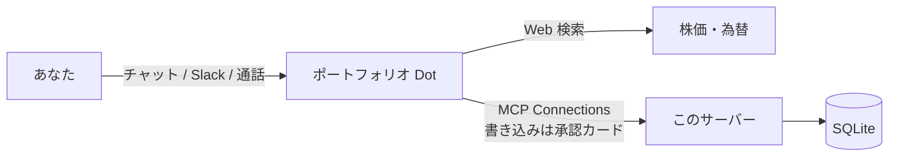

# OpenDots ポートフォリオ管理

[OpenDots](https://github.com/CopilotKit/OpenDots)（CopilotKit 製の AI 同僚テンプレート）の Dot に、**保有銘柄の管理機能**を追加する MCP サーバーです。

チャットで「トヨタを 100 株 2,850 円で買った」「今の含み損益は？」「価格を更新して」と話しかけるだけで、Dot が取引を記録し、損益を計算し、Web で調べた価格で評価額を更新します。



## できること

| 分野 | 内容 |
| --- | --- |
| 保有状況 | 口座別・銘柄別の数量、平均取得単価（移動平均法）、評価額、含み損益、構成比 |
| 配分分析 | 口座・資産クラス・セクター・通貨別の配分 |
| 取引 | 買付・売却の記録、保有数量を超える売却の拒否、さかのぼった取引の登録や削除時の整合チェック |
| 一括取込 | 証券会社などの CSV（日本語ヘッダー可、`2026/1/5` や `"2,000"` 形式も可）。1 行でもエラーがあれば何も登録しない。dry run あり |
| 外貨・投信 | 外貨建て銘柄は約定時の為替で円換算。投資信託は 1 万口あたりの基準価額に対応 |
| 実現損益 | 年別・口座別。特定/一般口座と NISA を分け、課税分の概算税額（20.315%）を表示 |
| 配当 | 税引前・源泉税・税引後を銘柄別・月別に集計 |
| NISA | 成長投資枠・つみたて投資枠の年間利用額と、生涯枠（簿価ベース）の残り |
| 推移 | 価格更新のたびに日次スナップショットを保存し、評価額の推移を表示 |

価格は外部 API から自動取得しません。Dot が Web 検索で調べて `update_prices` で登録します（不安定な非公式 API に依存しないため）。

## ツール一覧

読み取り専用のツールは OpenDots で自動実行され、それ以外は **Approve & run** の承認カードが出ます。

| ツール | 種別 | 説明 |
| --- | --- | --- |
| `portfolio_summary` | 読み取り | 概要・保有一覧・配分・今年の損益/配当・警告 |
| `list_holdings` | 読み取り | 保有銘柄（口座・銘柄で絞り込み） |
| `list_trades` | 読み取り | 取引履歴 |
| `realized_gains` | 読み取り | 実現損益と概算税額 |
| `dividend_report` | 読み取り | 配当集計 |
| `nisa_usage` | 読み取り | NISA 枠の利用状況 |
| `value_history` | 読み取り | 評価額の推移 |
| `list_accounts` | 読み取り | 口座・銘柄マスタ |
| `price_targets` | 読み取り | 価格更新が必要な銘柄と外貨 |
| `record_trade` | 書き込み | 売買を記録（初回は銘柄も自動登録） |
| `delete_trade` | 削除 | 取引を削除 |
| `import_trades_csv` | 書き込み | CSV から一括登録 |
| `record_dividend` / `delete_dividend` | 書き込み/削除 | 配当の記録・削除 |
| `update_prices` | 書き込み | 価格・為替の更新とスナップショット保存 |
| `upsert_security` / `upsert_account` | 書き込み | 銘柄・口座マスタの登録 |

## セットアップ

### 1. サーバーを起動

Node.js 22.13 以上（OpenDots と同じ Node.js 24 を推奨）が必要です。

```sh
npm ci
cp .env.example .env
# .env の MCP_TOKEN にランダムな文字列を設定（例: openssl rand -hex 32）
npm run build
npm start
# → Portfolio MCP server: http://127.0.0.1:4320/mcp
```

開発中は `npm run dev`（変更を監視して再起動）。

Docker の場合:

```sh
docker build -t opendots-portfolio .
docker run -d --name portfolio -p 127.0.0.1:4320:4320 \
  -e MCP_TOKEN=... -v portfolio-data:/data opendots-portfolio
```

OpenDots を Docker Compose で動かしている場合は、同じネットワークに入れて `http://portfolio:4320/mcp` で接続できます。

### 2. OpenDots に接続

1. OpenDots で Dot を作成します。設定例は [docs/dot-instructions.md](docs/dot-instructions.md) にあります。
2. Dot の **Edit specialist** → **Connections** で次のように入力し、**Connect** を押します。
   - Name: `portfolio`
   - URL: `http://127.0.0.1:4320/mcp`
   - Token: `.env` の `MCP_TOKEN`
3. ツール一覧が表示されれば完了です。スケジュール実行で価格を更新したい場合は、`update_prices` の **Ask first** をオフにします。

### 3. 使ってみる

```text
SBI の NISA 成長投資枠の口座を追加して（ID は sbi_nisa）
sbi_nisa で 1306 を 50 口 2,900 円で買った。TOPIX 連動型上場投資信託、ETF
AAPL を 10 株 230.5 ドルで買った。レートは 155.2 円
価格を更新して
今の含み損益と配分を教えて
今年の NISA 枠はあといくら使える？
```

CSV の書式は [examples/trades.csv](examples/trades.csv) を参照してください。

## 設定（.env）

| 変数 | 既定値 | 説明 |
| --- | --- | --- |
| `MCP_TOKEN` | （必須） | OpenDots の Connections に入れる Bearer トークン |
| `HOST` / `PORT` | `127.0.0.1` / `4320` | 待ち受けアドレス |
| `DATABASE_PATH` | `./data/portfolio.db` | SQLite ファイル |
| `BASE_CURRENCY` | `JPY` | 評価の基準通貨 |
| `TIMEZONE` | `Asia/Tokyo` | 「今日」の判定に使うタイムゾーン |
| `ALLOW_NO_AUTH` | — | `true` で認証なし起動（ローカルの動作確認専用） |

## 計算のルールと注意

- **取得単価**は口座ごと・銘柄ごとの移動平均法です。手数料は取得価額に含め、売却時は売却代金から差し引きます。
- **外貨建て**の取得額は約定時の為替レートで円換算します。評価額は登録済みの最新レートで換算します。
- **価格未登録**の銘柄は取得額で評価し、概要に警告を出します。
- **NISA の生涯枠**は、現在保有している NISA 口座の銘柄の簿価で概算しています。
- 実現損益と税額は**参考値**です。確定申告には証券会社の年間取引報告書を使ってください。
- データは SQLite の 1 ファイルです。`DATABASE_PATH` のファイルを定期的にバックアップしてください。トークンを含む `.env` と同じように扱ってください。

## 開発

```sh
npm test         # ロジックのテストと、MCP over HTTP の結合テスト
npm run typecheck
```

| ファイル | 役割 |
| --- | --- |
| `src/portfolio.ts` | 取引のリプレイ（移動平均法）と評価の純粋関数 |
| `src/service.ts` | 入力検証、トランザクション、レポート |
| `src/store.ts` | SQLite（`node:sqlite`） |
| `src/tools.ts` | MCP ツール定義と、モデル向けの Markdown 出力 |
| `src/http.ts` | Streamable HTTP（ステートレス）と Bearer 認証 |
